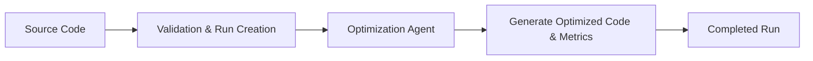
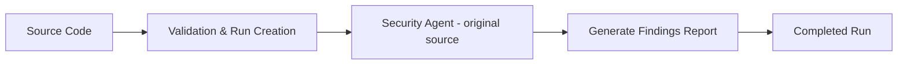
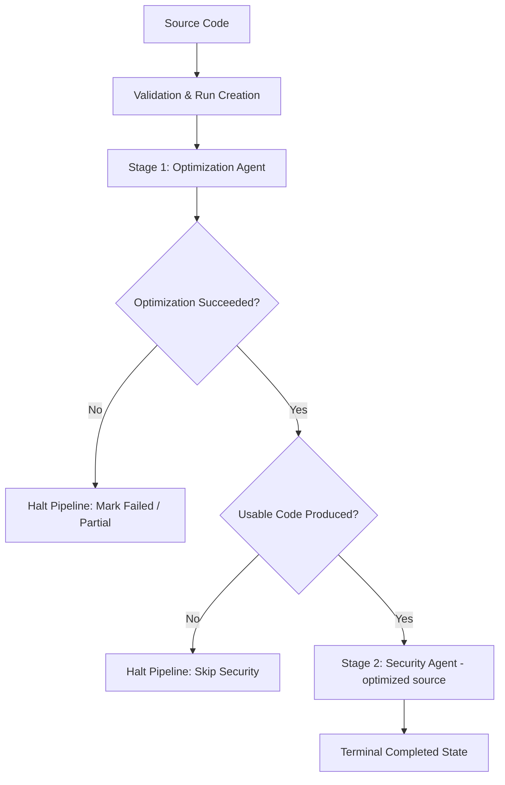

# CompilerAI — Pipeline Flows & Execution Contract

CompilerAI supports exactly three discrete execution modes.

---

## 1. Optimize Mode (`optimize`)

Only the Optimization Agent is invoked. Security analysis is omitted.

### Execution Steps
1. Request validation (verifies source code non-empty and language supported).
2. Assign unique `run_id`.
3. Emit `run_started`.
4. Invoke `OptimizationAdapter`.
5. Stream lifecycle, progress, and artifact events.
6. Validate structured `OptimizationResult`.
7. Store result in isolated `ResultStore`.
8. Transition run to `completed` (or `failed`).

---

## 2. Security Mode (`security`)

Only the Security Agent is invoked. Source code is evaluated in its original form (`source_kind: original`).

### Execution Steps
1. Request validation.
2. Assign unique `run_id`.
3. Emit `run_started`.
4. Invoke `SecurityAdapter` with `source_kind: original`.
5. Stream lifecycle, progress, and finding events.
6. Validate structured `SecurityResult`.
7. Store result in `ResultStore`.
8. Transition run to `completed` (or `failed`).

---

## 3. Full Pipeline Mode (`pipeline`)

Strictly sequential pipeline: **Optimization Agent → Security Agent**.

### Sequential Invariants
- **No Concurrency**: Under no circumstances are Optimization and Security run concurrently or via `asyncio.gather`.
- **Handoff Contract**: Security is executed strictly against the exact `optimized_code` artifact returned by Optimization.
- **Fail-Fast Boundary**: If Optimization fails or emits empty/null code, Security is skipped completely. The run is finalized as `partially_completed` or `failed` with clear diagnostics in Messages.
- **Partial Success Preservation**: If Optimization succeeds but Security fails, the Optimization artifact is preserved and presented in the `Optimized Code` tab, while the run is honestly labelled as `partially_completed`.
