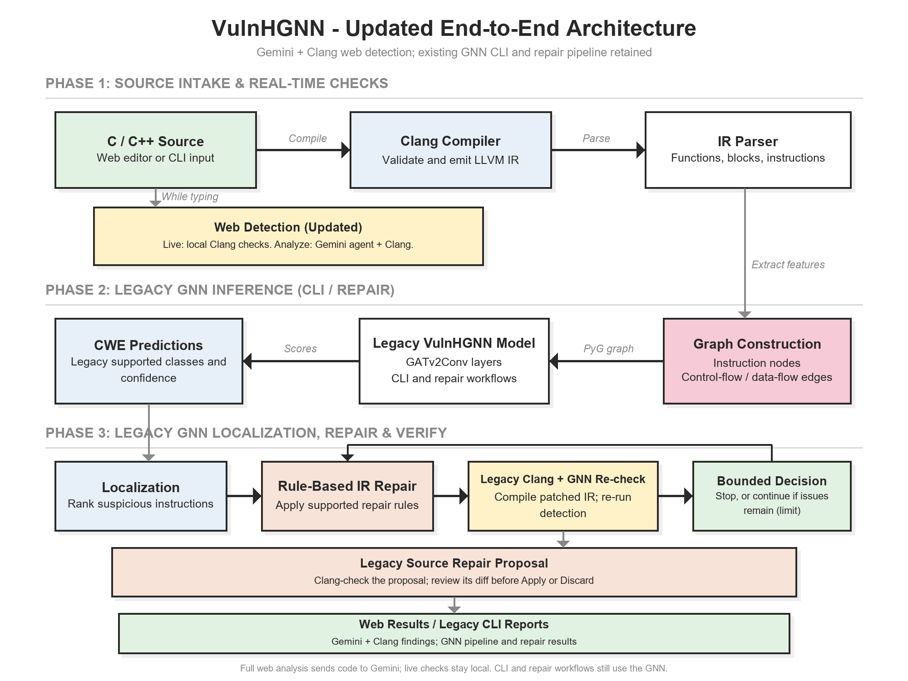
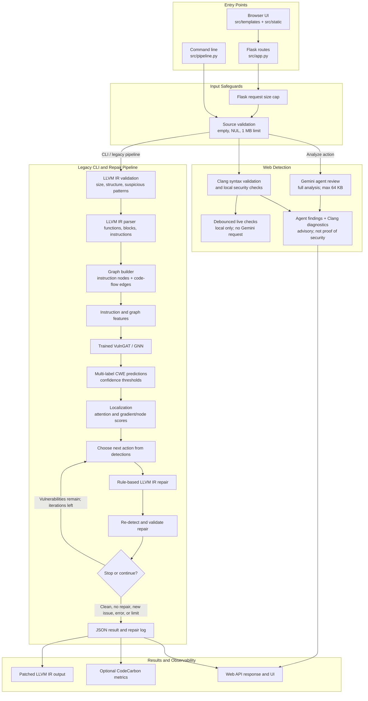

# VulnHGNN Architecture



## What changed from the original

| Area | Before | Now | How it helps |
|---|---|---|---|
| Web detection | Full detection used the local GNN. | Full web analysis now uses the configured Gemini agent plus local Clang checks. Live checks while typing stay local and do not call Gemini. | Replaces the GNN as the web app's primary detector while avoiding API calls on each keystroke. Gemini results are advisory, not proof. |
| Detection reliability | A source-path mismatch could remove user functions and return misleading zero scores. | Source paths are normalized, and empty analysis or inference failures return an explicit error. | Avoids showing a false “clean” result when analysis did not actually run. |
| Repair flow | A repair could be treated as ready without a clear review step. | Repairs are compiler-checked; source proposals are shown as a diff with Apply and Discard controls. | Rejects proposals that do not compile and leaves the user in control. Compilation does not prove a repair is safe or correct. |
| Agent loop | Detection and repair steps did not clearly expose why the loop stopped. | The bounded repair loop records whether it stops, continues, or reaches an error or limit. | Makes the repair result easier to follow and prevents an open-ended repair cycle. |
| Training split | Functions from one source file could be split across training and evaluation. | The split groups functions by source file. | Reduces file-level data leakage. The current checkpoint was not retrained, and fixture metrics are not a held-out benchmark. |

The web app's primary detector is now Gemini plus Clang. The legacy CLI, graph construction, GNN localization, and GNN-based repair pipeline remain available and are not replaced by this web-only change. The agent review does not execute code or apply repairs. Full web analysis sends source (up to 64 KB) to the configured provider on each Analyze action; live editor checks remain local.

## System Overview

The web app validates and compiles C/C++ source with Clang, runs local constant division-by-zero checks, and sends full-analysis source to the configured Gemini agent. A successful response supplies the advisory score and findings; if Gemini is unavailable, the endpoint returns an explicit error instead of falling back to GNN predictions. The CLI and legacy repair pipeline still compile source to LLVM IR, construct graphs, and use the trained GNN; patched IR is compiler-checked before GNN re-detection. Source repair proposals require explicit user review before changing editor content.



## Runtime Flow

1. **Submit source:** A user submits C/C++ through the web UI or selects a file through the CLI.
2. **Real-time editor checks:** While typing, the browser debounces requests and cancels stale checks. Clang validates syntax and checks for constant division-by-zero warnings; live checks never call Gemini.
3. **Apply input safeguards:** The Flask app imposes a request-body cap. Shared source validation rejects empty text, NUL bytes, and source larger than 1 MB before it is written for compilation. The healing loop repeats source validation before invoking the compiler, protecting the CLI path as well.
4. **Compile and validate IR:** Clang produces LLVM IR. The security module checks the IR's size, basic structure, function count, brace balance, and configured suspicious assembly patterns.
5. **Full web analysis:** Pressing Analyze sends source up to 64 KB to the configured Gemini provider on every request. Gemini findings are advisory; if review is unavailable, the endpoint fails explicitly rather than using the GNN as a fallback.
6. **Legacy CLI detection:** The CLI compiles to LLVM IR, builds function graphs, and uses the existing GNN for supported CWE prediction and localization.
7. **Legacy repair and verification:** The repair pipeline applies available rule-based IR patches. Clang compiles patched IR before GNN re-detection. Source repair proposals are compiler-checked and require explicit user review before changing editor content. Compilation confirms syntax/IR validity only, not that a repair is semantically correct or secure.
8. **Export audit evidence:** After web analysis, the browser can download agent findings, Clang checks, the agent score, and scope disclaimer as JSON. The report is assembled locally; the source is sent to the configured provider only for the full Analyze request. Editing source or changing languages invalidates the displayed report.

## Legacy GNN-Based Repair Cycle

```mermaid
sequenceDiagram
    participant User
    participant Guard as Input Security
    participant Loop as Healing Controller
    participant GNN as VulnHGNN Model
    participant Loc as Localization
    participant Fix as IR Repair Rules
    participant Check as Repair Validator

    User->>Guard: Submit source code
    Guard->>Guard: Check type, empty/NUL, and size
    Guard->>Loop: Accept valid source
    Loop->>GNN: Detect vulnerabilities in current IR
    GNN-->>Loop: CWE classes and confidence
    alt No vulnerabilities
        Loop-->>User: Stop: clean
    else Vulnerabilities detected
        Loop->>Loc: Score relevant instructions
        Loc-->>Loop: Ranked instructions
        Loop->>Fix: Apply available repair rules
        Fix-->>Loop: Patched IR and patch log
        Loop->>Check: Re-run detection and check for new CWEs
        Check-->>Loop: Remaining/new CWEs and validation result
        alt Clean and no new vulnerabilities
            Loop-->>User: Stop: repair verified
        else Repair unavailable, validation risk, error, or iteration limit
            Loop-->>User: Stop with status and iteration log
        else Issues remain and iteration budget remains
            Loop->>GNN: Analyze patched IR in next iteration
        end
    end
```

**Gemini scope:** The web agent reviews source and returns advisory findings; it has no tools, cannot execute code, and cannot change files. Every full web analysis sends source (up to 64 KB) to the configured provider. The bounded legacy repair loop remains deterministic and uses the GNN, repair rules, and validator; its `agent_decision` field records loop decisions.

## Component Map

| Concern | Main implementation |
|---|---|
| Web interface and API | `src/app.py`, `src/templates/`, `src/static/` |
| Gemini agent review for full web analyses | `src/llm_security_review.py` |
| CLI orchestration and result files | `src/pipeline.py` |
| Source and LLVM IR security checks; model diagnostics | `src/security.py` |
| Compile, detect, localize, repair, and validate iteration loop | `src/feedback_loop.py` |
| Model loading and predictions | `src/predict.py`, `src/pyg_model.py` |
| LLVM IR parsing and graph construction | `src/ir_parser.py`, `src/pyg_dataset.py` |
| Vulnerability localization | `src/localization.py` |
| IR repair | `src/ir_healer.py` |
| Repair verification and GNN re-detection | `src/validation.py` |
| Model training and evaluation | `src/train_pyg.py`, `src/train_gnn.py`, related training scripts |
| Carbon tracking | `src/carbon_tracker.py` |
| Checkpoints and generated reports | `results/`, `data/` |

## Existing Capabilities and Recent Additions

| Area | Existing project | Recent addition |
|---|---|---|
| Web detection workflow | Flask UI/API with GNN detection | Full web analysis uses Gemini plus Clang; Gemini failure is explicit and does not fall back to GNN |
| Legacy CLI and repair | CLI and bounded GNN-based repair pipeline | Shared source validation; source file path matching handles relative and absolute compiler paths; no analyzable graph is an explicit error |
| Real-time editor checks | Browser editor with a debounced local check | Local Clang syntax validation and constant division-by-zero warnings; no Gemini call while typing |
| Input security | Flask request-size cap and LLVM IR validation | Source text rejects empty input and NUL bytes and has a 1 MB cap |
| Self-healing | Rule-based IR repair followed by GNN re-detection and new-CWE checks | Iteration output records why the bounded loop continues or stops |
| Resource control | Healing loop has an iteration limit | API validates `max_iterations` as an integer from 1 through 5 |
| Model/runtime checks | Model stability helper and CLI pipeline stability check | No claim that model-health checks are applied to every web request |
| Web runtime | Local Flask UI/API | Flask debug mode is disabled when started directly |
| Gemini web review | Optional advisory | Runs on every full web analysis when configured; API errors explicitly if no review is available |
| Audit evidence | Results shown in the UI | Downloadable JSON report containing agent findings, Clang checks, agent score, timestamp, and disclaimer |
| Model evaluation split | Function graphs were randomly split, allowing functions from one file to cross splits | Training splits function graphs by originating source file; a diagnostic-fixture runner records metrics while warning it is not an independent benchmark |

## Security Scope

These safeguards reduce accidental or oversized input and provide basic validation before parsing and compilation. Each full web analysis sends source outside the application to the configured Gemini provider (up to 64 KB); review the provider's retention and training policies before sending proprietary code. Gemini results are untrusted advice, not proof of security. Live checks remain local. These safeguards do not make the application a hardened multi-user service by themselves. If deployed beyond a local demo, add authentication and authorization, rate limiting, isolated/time-limited compiler execution, restricted filesystem access, production-grade server configuration, and operational logging/monitoring.
