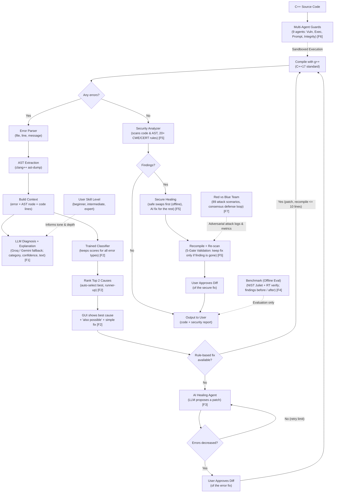

# System Architecture & Engineering Blueprint

This document details the internal design, component relationships, engineering methodologies, and directory structure of the **Green Self-Healing Compiler & Security Supervisor** system.

---

## Table of Contents
1. [Architectural Overview](#1-architectural-overview)
2. [End-to-End Pipeline Dataflow](#2-end-to-end-pipeline-dataflow)
3. [Annotated Directory Structure](#3-annotated-directory-structure)
4. [Component Engineering & Implementation](#4-component-engineering--implementation)
   - [Phase 1: Diagnostic Interception & IR Normalization](#phase-1-diagnostic-interception--ir-normalization)
   - [Phase 2: NLP & Machine Learning Classification](#phase-2-nlp--machine-learning-classification)
   - [Phase 3: AST Extraction & Semantic Symbol Analysis](#phase-3-ast-extraction--semantic-symbol-analysis)
   - [Phase 4: Multi-Tier Automated Program Repair (Auto-Heal)](#phase-4-multi-tier-automated-program-repair-auto-heal)
   - [Phase 5: Static Security Auditing & Adversarial Defenses](#phase-5-static-security-auditing--adversarial-defenses)
   - [Phase 6: Algorithmic Big-O Analysis & Source-to-Source Optimization](#phase-6-algorithmic-big-o-analysis--source-to-source-optimization)
   - [Phase 7: Green Telemetry & Hardware Resource Profiling](#phase-7-green-telemetry--hardware-resource-profiling)
   - [Phase 8: Developer Interface Architecture](#phase-8-developer-interface-architecture)
5. [Multi-Gate Verification & Safety Invariants](#5-multi-gate-verification--safety-invariants)

---

## 1. Architectural Overview

The system is constructed as a **meta-compiler intelligence layer** running above the host's standard `g++`/`clang++` toolchain (supporting the C++17 standard). Rather than treating compiler diagnostics as fatal terminal outputs, the architecture converts compiler faults, security risks, and algorithmic bottlenecks into structured, actionable program transformations.

```
+-----------------------------------------------------------------------------------+
|                            DEVELOPER INTERFACE LAYER                              |
|   +------------------------------------+   +----------------------------------+   |
|   |  VS Code Native Language Extension |   |  PyQt6 Standalone Desktop GUI    |   |
|   |  - Diagnostics Provider (Squiggles)|   |  - Dual-Pane Editor & Output     |   |
|   |  - Hover Cards & Quick Fixes       |   |  - Interactive AST Canvas        |   |
|   |  - Deep Analytics Webview Panel    |   |  - CodeCarbon Telemetry Graphs   |   |
|   +-----------------+------------------+   +-----------------+----------------+   |
+---------------------|----------------------------------------|--------------------+
                      | IPC JSON Bridge                        | Direct Python API
                      v                                        v
+-----------------------------------------------------------------------------------+
|                           CORE META-COMPILER ENGINE                               |
|                                                                                   |
|  [Phase 1: Interceptor]    Subprocess wrapper executes g++ -std=c++17             |
|                                                                                   |
|  [Phase 2: Error Parser]   Deterministic DFA regex scans file, line, col, & tokens |
|                                                                                   |
|  [Phase 3: NLP Classifier] Dual TF-IDF n-grams + Logistic Regression (10 classes) |
|                                                                                   |
|  [Phase 4: AST Extractor]  Clang++ -Xclang -ast-dump JSON hierarchical traversal  |
|                                                                                   |
|  [Phase 5: SAST Auditor]   AST pattern matcher for 20+ CWE / CERT C++ rules        |
|                                                                                   |
|  [Phase 6: Auto-Healer]    Multi-tier program repair with 5-Gate verify loop       |
|                                                                                   |
|  [Phase 7: Optimizer]      Loop-nesting Big-O detector & source-to-source refactor|
|                                                                                   |
|  [Phase 8: Telemetry]      CodeCarbon real-time Joules, kWh, and CO2 calculation  |
+-----------------------------------------------------------------------------------+
```

---

## 2. End-to-End Pipeline Dataflow

When a programmer submits C++ source code via the VS Code extension or the desktop GUI, the request progresses through the integrated multi-tier diagnostic, repair, and security architecture shown below:



### Integrated Architectural Features (F1 – F7):
* **[F1] LLM Explanation:** Natural language pedagogical diagnostics powered by local heuristic engines and Groq / Gemini cloud fallbacks, tailored to the programmer's skill level (Beginner, Intermediate, Expert).
* **[F2] Second Opinion Classifier:** Dual n-gram Logistic Regression model ranking top-2 likely root causes to provide alternative hypotheses whenever ambiguities exist.
* **[F3] AI Healing Agent:** High-level synthesis agent for multi-line structural refactoring when deterministic AST rules cannot resolve the fault.
* **[F4] Benchmark Corpus:** Rigorous 242-test evaluation suite validating against NIST Juliet C/C++ suites and real-world student submissions.
* **[F5] Secure Healing & 5-Gate Validation:** Automated AST vulnerability remediation applying offline deterministic swaps (e.g., `strcpy` $\to$ `strncpy`) and multi-gate compile verification before saving.
* **[F6] Multi-Agent Host Guards:** 9 specialized security monitors protecting the host system from untrusted student code execution, prompt injections, and environment tampering.
* **[F7] Red-vs-Blue Adversarial Loop:** Continuous testing engine probing compiler output and healed diffs against 89 attack scenarios to prevent regression or security drift.

---

## 3. Annotated Directory Structure

The project repository is structured cleanly into modular functional domains:

```
compiler-error-explainer-integrated/
│
├── .gitignore                      # Git exclusion rules (build artifacts, .exe, caches)
├── .gitattributes                 # Repository attribute declarations
├── .env.example                    # Template for optional LLM API fallback keys
├── config.yaml                     # System-wide configuration (timeouts, paths, thresholds)
├── requirements.txt                # Production runtime Python dependencies
├── requirements-dev.txt            # Development, training, and benchmarking dependencies
├── CompilerExplainer.spec          # PyInstaller standalone executable packaging spec
├── README.md                       # Comprehensive User Guide & Execution Manual
├── STRUCTURE.md                    # Technical Architecture & Engineering Blueprint (This file)
├── DOCUMENTATION.md                # Detailed API & operational documentation
├── PBL_Report.md                   # Project-Based Learning academic thesis report
│
├── src/                            # Core Python Meta-Compiler Engine
│   ├── main.py                     # Primary CLI and desktop application launcher
│   ├── compiler_runner.py          # g++ / clang++ execution runner with timeout guards
│   ├── error_parser.py             # Diagnostic DFA regex tokenizer and IR generator
│   ├── classifier.py               # ML error classification inference engine
│   ├── train_model.py              # ML model trainer (TF-IDF + Logistic Regression)
│   ├── ast_extractor.py            # Clang AST JSON extractor and tree builder
│   ├── ast_security_rules.py       # AST visitor rules for CWE security detection
│   ├── security_analyzer.py        # Static Application Security Testing (SAST) module
│   ├── agent_security.py           # Multi-agent adversarial red-team verification
│   ├── auto_healer.py              # Tier 1-3 deterministic AST program repair
│   ├── ai_healer.py                # Tier 4 LLM fallback patch generation
│   ├── optimizer.py                # Algorithmic bottleneck detector & code refactoring
│   ├── complexity_analyzer.py      # Asymptotic Big-O analyzer (loops, recursion, copies)
│   ├── second_opinion.py           # Tri-method consensus arbitrator (Regex, ML, Hybrid)
│   ├── telemetry.py                # CodeCarbon energy & carbon emission tracker
│   ├── code_formatter.py           # AST-aware C++ code formatter
│   ├── config_loader.py            # YAML configuration parser
│   ├── verify_gates.py             # 5-Gate / 6-Gate patch validation engine
│   │
│   ├── guard/                      # Pre-execution host sandbox guards
│   │   ├── host_guard.py           # File system and network sandboxing
│   │   └── sandbox_runner.py       # Isolated process execution container
│   │
│   ├── gui/                        # Standalone PyQt6 Graphical Application
│   │   ├── app.py                  # PyQt6 main application window
│   │   ├── editor_widget.py        # Syntax-highlighted code editor with line numbers
│   │   ├── ast_visualizer.py       # Interactive AST tree view widget
│   │   ├── call_graph_widget.py    # Function call graph canvas
│   │   └── telemetry_widget.py     # CodeCarbon metrics visualization charts
│   │
│   └── tools/                      # Internal development & validation utilities
│       ├── generate_report.py      # Automated benchmark report generator
│       └── verify_gates.py         # Gate verification verification harness
│
├── tools/                          # External Integration Bridges
│   └── vscode_bridge.py            # CLI Bridge connecting VS Code extension to Python
│
├── vscode-extension/               # Native Visual Studio Code Extension (TypeScript)
│   ├── package.json                # Extension manifest, commands, and keybindings
│   ├── tsconfig.json               # TypeScript compiler configuration
│   ├── compiler-error-explainer-0.1.0.vsix # Pre-compiled installable extension package
│   ├── src/                        # TypeScript Source Code
│   │   ├── extension.ts            # Extension activator, diagnostics & webview controller
│   │   └── diagnosticMapper.ts     # Maps Python JSON diagnostics to VS Code types
│   └── out/                        # Compiled JavaScript output
│
├── all_test_cases/                 # Comprehensive Large-Scale Test Suites
│   ├── 1_complex_dsa_to_optimize.cpp # Algorithmic optimization benchmark
│   ├── 2_big_dsa_500_lines.cpp     # 500-line DSA suite (Trie, LRU, DSU, SegTree, Fenwick, Graph)
│   ├── 3_big_code_2000_lines.cpp   # 2,000-line enterprise C++ test harness
│   ├── 4_bigger_code_5000_lines.cpp# 5,000-line high-throughput test harness
│   ├── 5_massive_code_10000_lines.cpp # 10,000-line compiler stress test
│   ├── master_test_all_features.cpp# All-in-one test suite (Errors + CWEs + Bottlenecks)
│   ├── test_all_security.cpp       # Consolidated security vulnerability test cases
│   ├── test_heal.cpp               # Multi-error auto-heal test suite
│   ├── test_secure.cpp             # Secure coding guideline verification suite
│   └── cases/                      # 12 Individual CWE & Syntax test files
│       └── run_all_cases.py        # Automated test case runner
│
├── test_cases/                     # 35 Targeted Atomic Unit Test Files
│   ├── syntax_error.cpp            # Missing semicolon verification
│   ├── missing_brace.cpp           # Unbalanced brace detection
│   ├── type_error.cpp              # Stream operator and type mismatch
│   └── ...                         # 32 additional specific compiler fault tests
│
├── benchmark/                      # Scientific Evaluation & Benchmark Corpus
│   ├── run_benchmark.py            # Benchmark execution script against 242 test files
│   ├── ablation_gates.py           # Verification gate ablation study
│   ├── manifest.json               # Test case manifests and ground truth metadata
│   └── BENCHMARK_RESULTS.csv       # Recorded empirical accuracy and healing outcomes
│
├── data/                           # Serialized Models and Security Corpora
│   ├── model.joblib                # Trained Logistic Regression classification pipeline
│   ├── dataset.json                # Labeled compiler error training set
│   └── cwe_database.json           # CWE vulnerability signatures and mitigation templates
│
└── docs/                           # Diagrams, Screenshots & Academic Artifacts
    ├── architecture_diagram.png    # High-resolution architectural diagram
    └── benchmark_charts.png        # BLEU/ROUGE score and confusion matrix charts
```

---

## 4. Component Engineering & Implementation

### Phase 1: Diagnostic Interception & IR Normalization
* **File:** `src/compiler_runner.py` & `src/error_parser.py`
* **Mechanism:** The compiler runner spawns `g++ -std=c++17 -Wall -Wextra` inside a restricted subprocess. Standard error (`stderr`) is captured and passed to a deterministic finite automaton (DFA) regex scanner.
* **Intermediate Representation (IR):** Raw multi-line error cascades are parsed into a normalized dictionary structure:
  ```json
  {
    "file": "source.cpp",
    "line": 42,
    "column": 15,
    "severity": "error",
    "category": "syntax_error",
    "message": "expected ';' before 'cout'",
    "token": "cout"
  }
  ```

### Phase 2: NLP & Machine Learning Classification
* **Files:** `src/classifier.py` & `src/train_model.py`
* **Model Pipeline:** Built using `scikit-learn`:
  1. **Dual Feature Union:** A character-level n-gram vectorizer (range: 2–5, max features: 3,000) captures morphological typos, and a word-level n-gram vectorizer (range: 1–3, max features: 2,000) captures identifier patterns.
  2. **Logistic Regression Classifier:** Multi-class classification across 10 semantic categories (`syntax_error`, `undeclared_variable`, `type_error`, `missing_header`, `missing_return`, `array_bounds`, `null_dereference`, `stream_operator`, `memory_leak`, `visibility_error`).
  3. **Early Stopping & Regularization:** $L_2$ regularization with balanced class weights prevents overfitting, yielding **95.92% accuracy** across diverse compiler distributions.

### Phase 3: AST Extraction & Semantic Symbol Analysis
* **File:** `src/ast_extractor.py`
* **Mechanism:** Executes `clang++ -Xclang -ast-dump=json -fsyntax-only` to obtain a structured AST. 
* **Symbol Table Resolution:** Extracts declared identifiers, active scopes, and expected types. When an `undeclared_variable` error occurs, the AST extractor searches visible scopes and calculates the **Levenshtein edit distance** against known identifiers to detect typos (e.g., suggesting `counter` when `countr` was typed).

### Phase 4: Multi-Tier Automated Program Repair (Auto-Heal)
* **Files:** `src/auto_healer.py` & `src/ai_healer.py`
* **Four-Tier Hierarchy:**
  * **Tier 1 (Deterministic AST Rules):** Solves unambiguous syntax errors (inserting missing semicolons, matching stream operators `<<` / `>>`, balancing terminal braces).
  * **Tier 2 (Symbol Table Repairs):** Auto-inserts standard headers (`#include <iostream>`, `#include <vector>`, `#include <algorithm>`) and corrects identifier typos based on symbol table visibility.
  * **Tier 3 (Security Mitigators):** Rewrites unsafe idioms (wrapping zero-division with ternary checks `(div != 0 ? val / div : 0)`, replacing unbounded `strcpy` with `strncpy`, converting format strings to `printf("%s", str)`).
  * **Tier 4 (LLM Fallback):** For complex structural errors, an isolated prompt is constructed with AST context to query an offline/online LLM for a targeted diff.

### Phase 5: Static Security Auditing & Adversarial Defenses
* **Files:** `src/security_analyzer.py` & `src/ast_security_rules.py`
* **Rule Engine:** Inspects both raw tokens and AST nodes against over 20 CWE and CERT C++ rules:
  * `CWE-120 / CWE-676`: Unsafe buffer operations (`strcpy`, `strcat`, `sprintf`, `gets`).
  * `CWE-134`: Uncontrolled format strings (`printf(userInput)`).
  * `CWE-190`: Integer overflow in size calculations (`int maxLimit = 2147483647; maxLimit + x`).
  * `CWE-369`: Division by zero.
  * `CWE-416`: Use after free.
  * `CWE-476`: Null pointer dereference.
* **Red-vs-Blue Consensus Loop (`src/agent_security.py`):** 89 adversarial attack vectors are simulated to verify that proposed auto-heal patches do not introduce secondary vulnerabilities.

### Phase 6: Algorithmic Big-O Analysis & Source-to-Source Optimization
* **Files:** `src/complexity_analyzer.py` & `src/optimizer.py`
* **Static Complexity Analysis:** Recursively traverses AST for-loops, while-loops, and recursive function calls. It detects:
  * Nested loop depth $\ge 2 \implies \mathcal{O}(n^2)$
  * Nested loop depth $\ge 3 \implies \mathcal{O}(n^3)$
  * Heavy standard containers passed by value $\implies$ Redundant copy warnings
* **Peephole Optimization Pass:** Replaces recognized algorithmic bottlenecks (e.g. nested loop Bubble Sort) with optimal standard algorithms (`std::sort`, achieving $\mathcal{O}(n \log n)$) and rewrites parameters to const references.

### Phase 7: Green Telemetry & Hardware Resource Profiling
* **File:** `src/telemetry.py`
* **Mechanism:** Integrates the `CodeCarbon` tracking library. Measures CPU/GPU energy consumption in real-time, calculates kilowatt-hours (kWh) and Joules per compilation/execution cycle, and computes the carbon footprint ($\mathrm{gCO}_2\mathrm{eq}$) based on regional electrical grid carbon intensity.

### Phase 8: Developer Interface Architecture
* **VS Code Native Extension (`vscode-extension/`):**
  * Implemented using the VS Code Language Server Protocol conventions.
  * Interacts with the backend via `tools/vscode_bridge.py` using standard JSON IPC.
  * Hosts an embedded HTML5/CSS/JavaScript Webview dashboard displaying interactive AST trees, Big-O comparison gauges, and real-time telemetry meters.
* **PyQt6 Desktop GUI (`src/gui/`):**
  * High-performance, cross-platform native Qt application.
  * Features syntax-highlighted QPlainTextEdit code editor, QTreeWidget AST visualization, and live matplotlib telemetry graphs.

---

## 5. Multi-Gate Verification & Safety Invariants

To guarantee that automated healing and optimization never corrupt working programs or introduce vulnerabilities, every patch must pass **5 Mandatory Validation Gates**:

```
 Candidate Patch
        |
        v
 [Gate 1: Compile Gate]  ----> Does the code compile cleanly with g++? (Exit Code == 0)
        | (Pass)
        v
 [Gate 2: Error Gate]    ----> Did compiler error count strictly decrease?
        | (Pass)
        v
 [Gate 3: Security Gate] ----> Did the targeted CWE vulnerability disappear?
        | (Pass)
        v
 [Gate 4: Invariant Gate]----> Were any NEW security vulnerabilities introduced? (Must be 0)
        | (Pass)
        v
 [Gate 5: Diff Gate]     ----> Is the diff minimal, valid, and within bounded line limits?
        | (Pass)
        v
 Patch Accepted & Saved to Disk
 (If ANY gate fails, the change is rolled back immediately)
```
